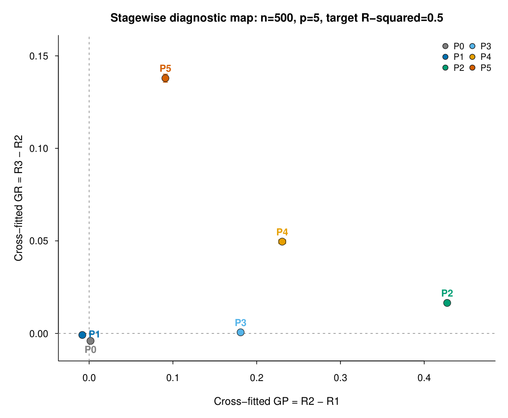
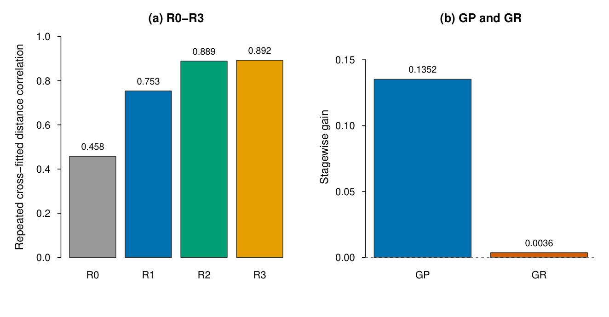
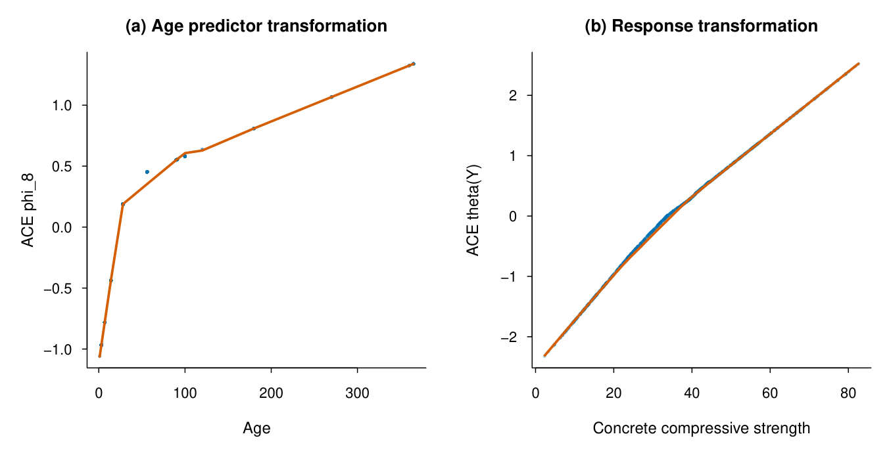

# ACE–거리상관 | 비선형 의존성 진단 연구

[상세 포트폴리오](https://app.notion.com/p/3fd6458e68be8150aad7d9f698b545f0?pvs=204) · [프로필](https://github.com/donghwan-analytics)


**비선형 변환의 효과를 하나의 점수로 묶지 않고, 어느 단계에서 관계가 더 포착되는지 검증했습니다.**
제1저자 · p-to-one 방법론 연구 · KJAS 투고 · Manuscript ID 26045

## 연구 개요
여러 예측변수와 하나의 반응변수 사이에서 비선형 관계를 진단하는 ACE–거리상관 프레임워크를 연구했습니다. **비교 기준의 차원, 학습자료 재사용에 따른 낙관적 평가, 복잡한 상호작용에서의 한계**를 분리해 검증했습니다.
기본 192,000회와 확장 504,000회의 모의실험을 설계하고, Concrete 실자료에 적용했습니다. 실자료에서는 선형점수 대비 ACE 점수의 거리상관이 **0.7534 → 0.8886**으로 증가했으며, 반응변수 변환의 추가 증가는 작았습니다.
## 담당 업무 및 연구 범위
제1저자로 연구 설계, R 기반 파일럿·본 실험, 실자료 검증과 원고 작성을 수행했습니다. Park & Kim의 1-to-1 선행연구를 출발점으로 삼았으며, 이 페이지는 **Noh & Kim의 p-to-one 후속 연구**를 다룹니다.
---
## 연구 설계 및 검증 방법
### 1. 동일 차원의 비교 기준 설정
다차원 원자료와 일차원 점수의 거리상관에는 차원과 거리 구조의 차이가 섞입니다. 원자료의 거리상관 R0는 참조치로 남겨두고, 동일한 일차원 점수끼리 비교하도록 기준을 바꿨습니다.
| 단계 | 비교 대상 | 의미 |
| --- | --- | --- |
| R1 | 선형점수와 원래 반응변수 | 비교 기준 |
| R2 | ACE 점수와 원래 반응변수 | 점수를 바꾼 뒤 포착한 관계 |
| R3 | ACE 점수와 변환된 반응변수 | 반응변수 변환 이후의 관계 |
**GP = R2 − R1 / GR = R3 − R2**
### 2. 교차적합을 통한 학습·평가 분리
파일럿의 표본 내 비교에서 학습·평가 분리로 설계를 발전시켰습니다. 최종 주평가는 2-fold cross-fitting을 사용하고, 5-fold·평활화 설정·예측변수 상관·오차분포를 바꾸어 민감도를 확인했습니다.
학습 폴드의 표준화 기준과 추정 변환함수를 평가 폴드에 적용했습니다. ACE 변환곡선은 구간별 선형보간과 경계값 연장 규칙으로 새 관측값에 적용했습니다.
### 3. 예측변수 차원과 신호 복잡도의 분리 평가
총 예측변수 수 p와 실제 신호에 참여하는 변수 수 s를 분리했습니다. P6–P12 확장 실험에서는 활성 변수 수를 2·5·10으로 바꾸어 가법 비선형, 상호작용, 임계값 구조 등을 비교했습니다.

---
## 실자료 검증 · Concrete Compressive Strength
관측치 **1,030개**, 예측변수 **8개**를 대상으로 2-fold cross-fitting을 100회 반복했습니다.

| 측도 | 평균 | 반복 분할 SD |
| --- | --- | --- |
| R1 · 선형점수 | 0.7534 | 0.0031 |
| R2 · ACE 점수 | 0.8886 | 0.0024 |
| R3 · 반응변수까지 변환 | 0.8923 | 0.0024 |
| GP | 0.1352 | 0.0027 |
| GR | 0.0036 | 0.0004 |
주요 증가는 선형점수를 ACE 점수로 바꾸는 단계에서 관찰됐습니다. 반응변수 변환을 더한 GR는 매우 작았습니다. 표의 SD는 **자료 분할에 따른 변동**으로 표본추출 표준오차나 신뢰구간이 아닙니다.

## 적용 한계 및 추론 민감도
- **고차 상호작용 P12:** 관계가 존재해도 단계별 증가량이 거의 0에 가까울 수 있었습니다. 참 신호 기준과 비교해 가법적 ACE 표현의 한계를 확인했습니다.
- **GR의 추론 민감도:** 같은 분할에서 잔차·Rademacher·Mammen bootstrap에 따른 p값이 각각 .999·.001·.200으로 달랐습니다. 작은 GR의 유의성보다 **큰 GP와 작은 GR라는 효과크기 패턴**을 중심으로 해석했습니다.
- **해석 범위:** 증가량은 예측 정확도·R² 개선율이나 인과효과가 아닙니다. ACE가 변환을 공동 추정하므로 GP를 예측변수 변환만의 순수 기여로 분해하지 않습니다.
---

### 연구 기여와 이론적 조건
기여는 ACE에 여러 변수를 넣는 것 자체가 아니라, 비교 가능한 단계별 진단량과 독립적인 평가 절차를 결합한 점에 있습니다.
선택된 모집단 ACE 해에 대한 진단 대상을 정의하고, 각 폴드에서 학습한 점수·변환함수의 L2 일치성 등 조건 아래 교차적합 진단량의 확률수렴을 정리했습니다.
이론적 조건과 경험적 bootstrap 보정은 구분하며, 모든 분포에 유효한 정식 검정을 확립했다고 주장하지 않습니다.


### 구현 안정성 및 재현성 설계
대규모 반복 실행 전에 ACE 호출 인수의 자료형과 유효성을 점검하도록 구성했습니다. v6 구현에는 maxit의 double 변환, 필수 인수 검사 및 사전 실행 점검이 포함되어 있습니다.
결과 수치는 투고본을 기준으로 제시합니다. 수록 코드는 연구 당시 구현이며, 별도 환경에서의 전체 Monte Carlo 재실행 검증을 포함하지 않습니다.

## 주요 구현 코드
**연구 구현:** 본 실험·실자료 분석 및 추가 검증
- `MAIN_simulation_and_concrete_2026_v6_.R`: 기본 시뮬레이션과 Concrete 분석.
- `MAIN_P6_P12_2026.R`: 확장 시나리오 실험.
- `p_to_one_SUPPLEMENT_REVIEWER_CHECKS_2026.R`: 추가 진단 및 민감도 검토.
**실행 조건:** 각 스크립트의 패키지·입력자료·출력 경로를 설정해야 합니다. 대규모 반복 실험을 포함하므로 실행 범위를 확인해야 합니다.
주요 구현은 `R/`에 수록했습니다. 개인 PC 경로 설정을 변경한 파일은 `SOURCE_MANIFEST.json`에 기록했습니다. 전체 데이터·실행환경을 포함한 배포 패키지는 아닙니다.

## 투고본 PDF
**The Korean Journal of Applied Statistics · Manuscript ID 26045**
접수번호와 FOR REVIEW 표지가 포함된 심사용 투고본입니다. 게재 확정본이 아닙니다.
[투고본 PDF는 Notion 상세 페이지에서 확인](https://app.notion.com/p/3fd6458e68be8150aad7d9f698b545f0?pvs=204)

## 저장소 파일

- [`MAIN_simulation_and_concrete_2026_v6_.R`](R/MAIN_simulation_and_concrete_2026_v6_.R)
- [`MAIN_P6_P12_2026.R`](R/MAIN_P6_P12_2026.R)
- [`p_to_one_SUPPLEMENT_REVIEWER_CHECKS_2026.R`](R/p_to_one_SUPPLEMENT_REVIEWER_CHECKS_2026.R)

## 실행 및 재현 안내

저장소 루트에서 R을 실행하고 `requirements-r.txt`의 패키지와 각 분석의 입력자료를 준비합니다. 원본 분석 스크립트는 패키지 설치, 결과 파일 생성, 병렬 작업을 수행할 수 있으므로 실행 범위와 경로를 먼저 확인해야 합니다.

```r
# 저장소 루트에서 실행
Sys.setenv(PORTFOLIO_PROJECT_DIR = getwd())
source("tools/preflight.R")
# 설정·입력자료 확인 후 분석 스크립트 실행
# source("R/MAIN_simulation_and_concrete_2026_v6_.R")
```

- `preflight.R`는 구문과 주요 패키지만 검사하며 분석을 실행하거나 패키지를 설치하지 않습니다. 자료의 존재·변수 구조·평가기간은 개별 스크립트에서 확인해야 합니다.
- 이 포트폴리오 구성 환경에는 R이 없어 구문 검사와 분석 재실행을 수행하지 않았습니다. 결과 수치는 기존 보고서·투고 원고에 근거합니다.
- `requirements-r.txt`는 주요 의존성 목록이며 정확한 버전을 고정하는 잠금파일이 아닙니다.
- `SOURCE_MANIFEST.json`에는 원본 및 준비본 SHA-256과 변경 범위를 기록했습니다. 계산 로직은 변경하지 않았습니다.
- 데이터와 선행 분석 결과가 필요한 스크립트는 해당 입력 없이 단독 실행할 수 없습니다.

## 자료 및 권리

개인·팀 연구의 구현 사례를 설명하기 위한 포트폴리오입니다. 별도의 재사용 라이선스를 부여하지 않았으며 팀 공동 산출물과 연구자료의 권리는 해당 권리자에게 있습니다.
